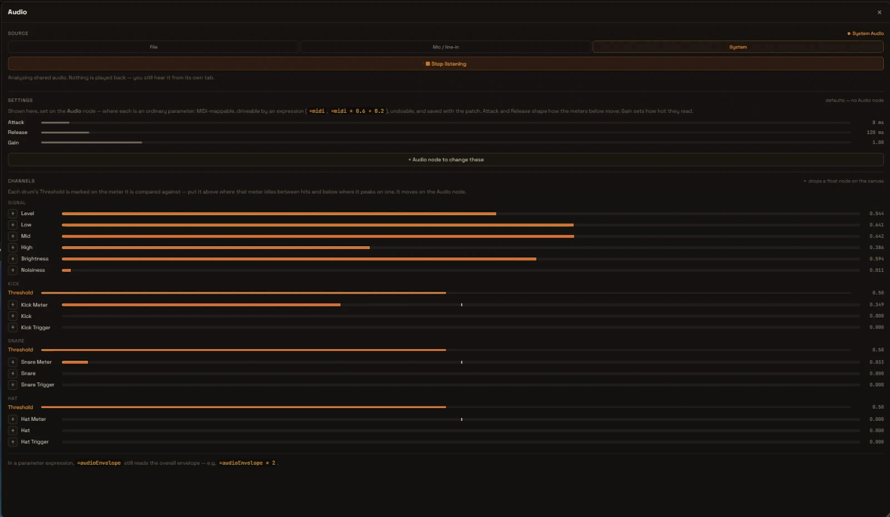

# Audio Reactivity

Make your visuals react to music and sound! Rhizomium includes built-in audio analysis, with no extra software needed.

---

## Quick Start

### Step 1: Turn on the audio

1. Open **Tools → Audio…** (`Cmd/Ctrl+Alt+A`)
2. Pick a source: **File**, **Mic / line-in**, or **System**
3. Load a track and press **Play**, or press **Listen** for a live input
4. The channel meters down the panel start moving

### Step 2: Use Audio in Parameter Expressions

Audio reactivity works through **parameter expressions**: type `=` followed by an expression into any numeric parameter field. The audio level is available as the `audioEnvelope` variable:

1. Select a node (e.g. a Circle)
2. Click into a parameter field (e.g. `Radius`)
3. Type `=audioEnvelope * 0.5`

The parameter now follows the audio level every frame. See [Parameter Expressions](parameter-expressions.md) for the full expression syntax.

### Step 3: Pick a Frequency Band

Several audio variables are available in expressions:

- `audioEnvelope` - Overall intensity (smoothed)
- `audioEnvelopeBass` - Low frequencies (kick drums, bass) — the panel's **Low** meter
- `audioEnvelopeMids` - Middle frequencies (vocals, guitars) — the panel's **Mid** meter
- `audioEnvelopeHighs` - High frequencies (hi-hats, cymbals) — the panel's **High** meter
- `audioEnvelopeFull` - Total energy — the panel's **Level** meter

All values range from **0.0 to 1.0**.

The four band variables read exactly the number their meter in the Audio panel
shows, so watching the meter tells you what an expression will get. They are
levelled automatically: a loud master and a quiet mic land in the same range,
sitting around the middle on ordinary music and rising toward the top on hits.
The Audio node's **Attack**, **Release** and **Gain** shape them the same way
they shape the meters (see [Meter Shape](#meter-shape)). `audioEnvelope` is a
separate, self-normalising follower and is not affected by those settings.

---

## Example Patterns

### Pulsing Circle

Make a circle pulse to the beat — on a Circle node, set:

```
Radius = 0.15 + audioEnvelopeBass * 0.3
```

The circle grows with bass hits!

### Color Changes

Shift colors with different frequencies — on a Color Adjust (compute) node, set:

```
hue = audioEnvelopeMids * 180
```

### Rotation Speed

Control rotation speed with audio — on a Rotate 2D node, set:

```
Rotation = time * (30 + audioEnvelopeHighs * 300)
```

### Multi-Band Visualization

Use all frequency bands on three Circle nodes:

```
Circle 1: Radius = audioEnvelopeBass * 0.4
Circle 2: Radius = audioEnvelopeMids * 0.4
Circle 3: Radius = audioEnvelopeHighs * 0.4
```

---

## Audio Sources

Three tabs at the top of the Audio panel. Only one runs at a time — starting a
live input pauses the file.

### File

**Best for**: building a patch against a known track, rehearsing a set

Load an MP3, WAV or OGG, then **Play** / **Pause**. **Stop** returns to the
start, the loop button repeats the track, and the progress bar scrubs.

### Mic / line-in

**Best for**: live performance, an instrument, a room mic

Press **Listen** and allow microphone access, then pick the input from the
device menu. Echo cancellation, noise suppression and auto-gain are all turned
off: they are built for speech, and auto-gain in particular flattens exactly
the loud/quiet difference a threshold discriminates on. Nothing is monitored
back to the speakers, so there is no feedback loop.

### System

**Best for**: Spotify, YouTube, a DJ app — anything already playing

Press **Listen**, then pick a window or screen in the share picker and
**tick the share-audio box**. Without that tick the stream arrives with no
audio track at all; the panel says so rather than sitting silently at zero.

Nothing is played back — you still hear the audio from the app that is
playing it.

No loopback driver, "Stereo Mix" device or third-party routing software is
needed for any of this.

---

## The Audio Panel



**Tools → Audio…** (`Cmd/Ctrl+Alt+A`). Three sections: the source tabs, the
meter shaping, and a live meter for every analysis channel.

**The panel shows the settings; it does not set them.** Every number in it is a
readout. They are parameters of the **Audio node**, and that node is the only
place they can be changed — which is the point: a node parameter can be
MIDI-learned, driven by an expression (`=midi * 0.6 + 0.2`), undone, and saved
with the patch, none of which a slider in a panel could be.

With no Audio node in the patch the analysis runs on the defaults below and the
section is headed *"defaults — no Audio node"*. The button under it adds one
(seeded with the values as they stand), and once the patch has one it reads
*"Edit on Audio #N"* and takes you there.

### Meter Shape

| Setting | Range | Default | What it does |
|---------|-------|---------|--------------|
| **Attack** | 1-200 ms | 8 ms | How fast a meter rises — short enough to catch a transient |
| **Release** | 1-2000 ms | 120 ms | How fast it falls — long enough that a hit stays visible for a few frames |
| **Gain** | 0-8 | 1 | How hot the meters read. At 0 every meter is dead |

These change what the meters *look like*, which in turn changes what a threshold
has to be set to. They are not a second detector. They also shape the
`audioEnvelopeBass`, `audioEnvelopeMids`, `audioEnvelopeHighs` and
`audioEnvelopeFull` expression variables, which read the Low, Mid, High and
Level meters — raise **Release** for a slower, smoother pulse, raise **Gain** if
a band barely moves. `audioEnvelope` is not affected. On the Audio node they sit
under a **Meter Shape** group, collapsed — set once and left alone.

### Channels

Four groups, each row showing what that channel reads right now:

| Group | Rows |
|-------|------|
| **Signal** | Level, Low, Mid, High, Brightness, Noisiness |
| **Kick** / **Snare** / **Hat** | Threshold, then *Meter*, the envelope, and *Trigger* |

**Level**, **Low**, **Mid** and **High** are overall and per-band loudness;
**Brightness** and **Noisiness** are the spectrum's centroid and density. In a
drum group, **Meter** is the signal that drum's threshold is compared against,
the bare name is its envelope, and **Trigger** reads 1 for a single frame when
it fires.

Each drum's **Threshold** (0-1, default 0.5) is a readout too, and it draws a
marker on the Meter row below it — which is the only way one is ever found. Put
it **above** where that meter idles between hits and **below** where it peaks on
one, then change it on the Audio node, where it lives under a **Triggers**
group.

A threshold set *below* the idle level holds the trigger permanently open, which
produces **fewer** triggers rather than more.

### Getting a channel onto the canvas

The **＋** beside a row drops an **Audio Value** node on the canvas reading that
channel — a float you can wire into anything. It is the only way to add one: the
node is hidden from the Add Node palette, because a channel is chosen by
watching it move, and this is the one place that shows all fifteen at once.

Every tap on a channel reads the same number its meter shows, and the drums are
thresholded once for the whole patch — two nodes reading Kick Trigger are two
views of one kick and fire on the same frame.

> Expressions and channels are two routes to the same analysis. The band
> variables work in any parameter expression and read the same numbers as the
> Level, Low, Mid and High rows (`audioEnvelopeFull`, `audioEnvelopeBass`,
> `audioEnvelopeMids`, `audioEnvelopeHighs`). The other channels — including the
> drum triggers and meters, which have no expression variable — are reached by
> deploying an Audio Value node. For something that sits at zero between kicks
> and jumps on each one, use the **Kick** meter that way rather than
> `audioEnvelopeBass`, which also hears the bassline.

---

## Tips for Audio Reactivity

### 1. Use Multipliers

Audio values are 0-1, but you may want larger ranges:

```
=audioEnvelope * 10
```

### 2. Add Offsets

Ensure a minimum value:

```
=0.5 + audioEnvelope * 0.5
```

### 3. Interpolate Between Bounds

Map audio into an exact range:

```
=lerp(0.2, 0.8, audioEnvelope)
```

### 4. Combine Frequencies

Mix different bands:

```
=(audioEnvelopeBass + audioEnvelopeHighs) * 0.5
```

### 5. Gate Quiet Signals

Only react above a threshold:

```
=audioEnvelope > 0.5 ? audioEnvelope : 0
```

---

## Common Patterns

### Reactive Size

```
Circle Radius = 0.1 + audioEnvelopeBass * 0.4
```

### Reactive Speed

```
Rotation = time * (1 + audioEnvelope * 10)
```

### Reactive Complexity

```
Noise Scale = 3 + audioEnvelope * 10
```

### Reactive Position

```
Translate X = audioEnvelopeMids * 0.2
```

### Beat-Reset Feedback

Wire an audio-driven signal through a **Trigger** node into the **Reset** pin of a Compute Feedback node to clear trails on the beat.

---

## Troubleshooting

### Every channel reads 0

**Problem**: the meters sit at zero and the panel's chip says "Not listening"
or "Paused"

Nothing is feeding the analysis — a node reading a channel is not broken, the
patch just has no audio in it. The way out depends on the tab you are on:

**Solutions**:
1. On **File**, load a track and press Play
2. On **Mic / line-in** or **System**, press **Listen**
3. On **System**, check you ticked the share-audio box in the picker — without
   it the stream carries no audio track
4. Check Windows **Settings → Privacy & security → Microphone**, and test the
   mic in another app
5. Check **Gain** is not at 0 — it kills every meter. It is on the Audio node,
   not in the panel

### Audio Not Reacting

**Problem**: An `=audioEnvelope…` expression is set but nothing happens

**Solutions**:
1. Check the panel's meters are moving — if they are not, see above
2. Check the expression starts with `=` and uses a valid variable name
3. For a band variable, watch its meter (Low for `audioEnvelopeBass`, Mid,
   High, Level for `audioEnvelopeFull`): it is the same number. If the meter
   barely moves, raise **Gain** on the Audio node (add one from the Audio panel
   if the patch has none)
4. Try a different frequency band

### Too Sensitive

**Problem**: Visual reacts too much to audio

**Solutions**:
1. Lower **Gain** on the Audio node (band variables only)
2. Raise **Release** on the Audio node so the meters, and the band variables,
   fall more slowly
3. Clamp the expression, e.g. `=clamp(audioEnvelope * 2, 0, 1)`
4. Scale it down, e.g. `=audioEnvelope * 0.5`

### Too Subtle

**Problem**: Barely visible reactions

**Solutions**:
1. Raise **Gain** on the Audio node (band variables only)
2. Multiply audio value (×2, ×5, ×10)
3. Use different frequency band (Bass often strongest)
4. Check audio source volume

### A drum trigger never fires, or never stops

**Problem**: a Kick / Snare / Hat Trigger channel stays at 0, or sits at 1

Watch that drum's **Meter** row in the panel while the track plays — the marker
on it is where the threshold currently sits. It has to be **above** where the
meter idles between hits and **below** where it peaks on one. Set under the idle
level, the trigger is held permanently open and fires less, not more.

Move it on the Audio node, under **Triggers**. The panel's threshold row is a
readout; if the patch has no Audio node, add one with the button in the Settings
section and the current value comes with it.

---

## Performance Notes

Audio analysis runs in real-time with minimal performance impact:
- **CPU**: ~1-2% usage for audio processing
- **GPU**: No additional load
- **Latency**: <10ms response time

Safe to use even with complex visuals!

---

## Privacy & Security

- **Microphone access** is required for audio reactivity
- Audio is **processed locally** on your computer
- **No data is sent** to any server
- You can revoke microphone access anytime in Windows **Settings → Privacy & security → Microphone**

---

## Next Steps

- **[Node Reference](node-reference.md)** - See all audio-compatible parameters
- **[Performance Tips](performance.md)** - Optimize audio-reactive visuals
- **[FAQ](faq-web.md)** - Common audio questions

---

_Let the beat drive your visuals!_
