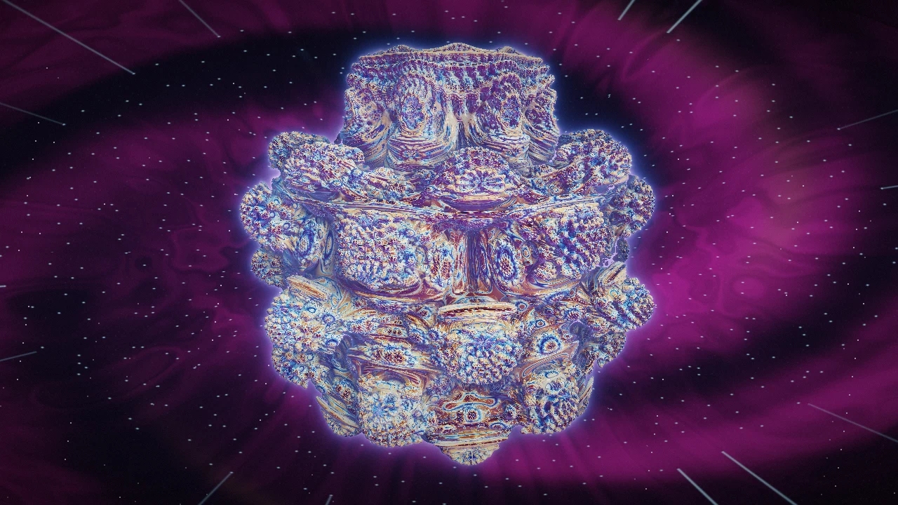

# Example patches

Open any `.rz` here with **File → Open** or by dropping it on the editor.

## bulb-nebula.rz

A raymarched Mandelbulb hanging in a deep-space nebula. 15 nodes:

| Stage | Nodes |
| --- | --- |
| Sources | `UV`, `Time` |
| Domain shaping | `Twirl`, `Spherize`, `PolarCoordinates` |
| Fields | `WarpNoise` and `RidgedNoise` (on the twirl), `FBMNoise` (on the spherize), `VoronoiNoise` (on polar coordinates) |
| Drivers | **Bulb Power** (`Expr`): `8.0 + 1.5 * sin(a * 0.17)`, so the fractal slowly morphs; **Crystal Sparks** (`Expr`): radial light streaks from the Voronoi field |
| Shading | **Nebula** (`CustomGLSL`): clouds, dust lanes, hot filaments, twinkling stars. **Mandelbulb** (`CustomGLSL`): a 120-step sphere tracer with orbit-trap colour, tetrahedral normals, step-count occlusion, fresnel rim and volumetric glow, orbiting camera |
| Finish | **Lens & Grade** (`CustomGLSL`): composite, bloom lift, ACES tonemap, vignette, film grain → `OutputFinal` |

The power, camera orbit and star twinkle all follow `Time`, so every frame
differs. It's heavy: each pixel runs up to 120 × 8 fractal iterations, plus
four more fractal evaluations for the surface normal. On a weak GPU, lower the output resolution.
